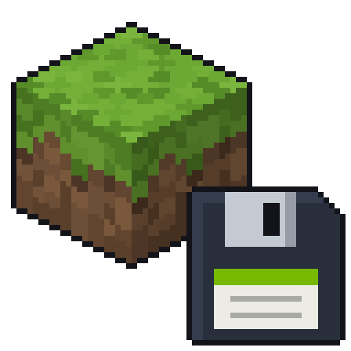

<p align="center">
  
</p>

<h1 align="center">NviCache</h1>

<p align="center">
  <a href="https://modrinth.com/mod/nvicache">Modrinth</a> ·
  <a href="https://discord.gg/r5Re8wCDkU">Discord</a> ·
  <a href="https://www.patreon.com/Kimberlite">Patreon</a>
</p>

NviCache remembers what Nvidium has already rendered, so your entire previously loaded world
appears instantly the next time you join.

Despite the fact that mods like Voxy and Distant Horizons already exist, 
the Nvidium + NviCache combination is more performant and can work together with these mods, 
allowing, for example, fewer FPS drops when turning your head and moving.

## How it works

- When you leave a world (or change video settings), the built terrain is saved to disk.
- When you join that world again, it's loaded straight back into the Nvidium renderer.

## Limitations

By default the cache is limited to **1 GB** per world. When it hits the limit, the chunks
farthest from you are dropped first.

You can change the limit in-game:

| Command | What it does |
|---|---|
| `/nvicache maxCacheSizeMb` | Show the current limit |
| `/nvicache maxCacheSizeMb <mb>` | Set a new limit (`0` = no limit) |
| `/nvicache maxCacheSizeMb default` | Reset to 1024 MB |

The new limit applies the next time the cache is saved. Settings are also stored in
`config/nvicache.json`.

## Requirements

- Minecraft **1.21.1**, **NeoForge**
- [Sodium](https://modrinth.com/mod/sodium) **0.8.13+**
- **Acedium 0.4.2+** (Nvidium for NeoForge)
- An NVIDIA GPU that Nvidium supports

## Building

Sodium and Acedium are not included in this repository. Put their jars into `libs/` first:

```
libs/
├── acedium-0.4.2+mc1.21.1.jar                      Acedium release jar
├── sodium-neoforge-0.8.13+mc1.21.1-mod.jar         inner mod jar, see below
└── run-mods/
    └── sodium-neoforge-0.8.13+mc1.21.1.jar         Sodium release jar from Modrinth
```

The inner mod jar is inside the Sodium release jar at
`META-INF/jarjar/net.caffeinemc.sodium-neoforge-0.8.13+mc1.21.1-mod.jar`: extract it and
rename it as above.

Then run `gradlew build`; the mod jar ends up in `build/libs/`. `gradlew runClient` starts
the game with Sodium and Acedium loaded.

## Follow me

- Twitter / X: https://x.com/Kimberlite_y
- Instagram: https://www.instagram.com/kimberlite_x
- Discord: https://discord.gg/r5Re8wCDkU

## Support me

- Patreon: https://www.patreon.com/Kimberlite
- Bitcoin: `bc1qakc7nkwf28ns9k0tpapxdcus7mkuw6rcy7thp8`
- USDC: `0x7a8830d6E1fDb12c8c3d206A4b354C3CaBf2083a`
  - Any EVM network: Ethereum, Base, Polygon, Arbitrum…

## License

NviCache is licensed under the [GNU LGPL-3.0](LICENSE).
